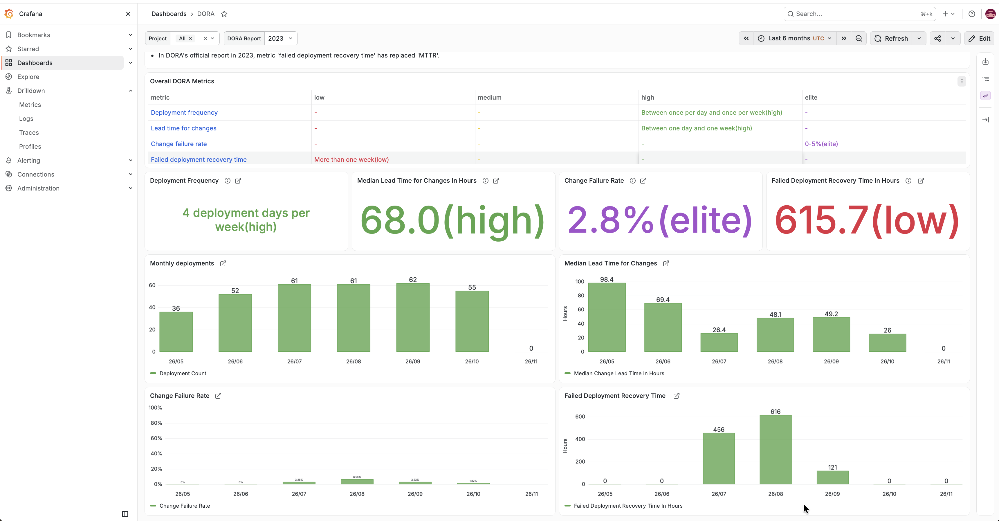
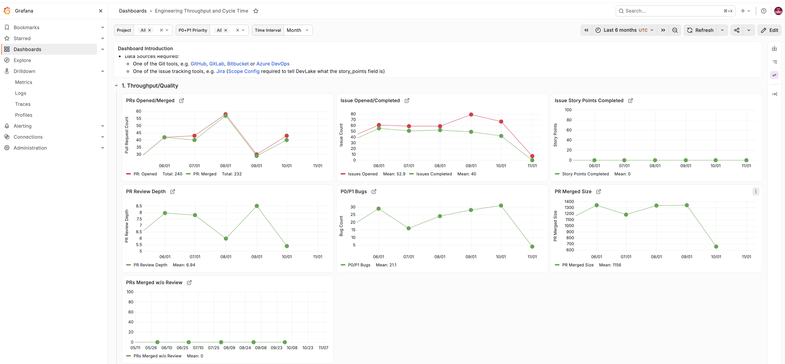
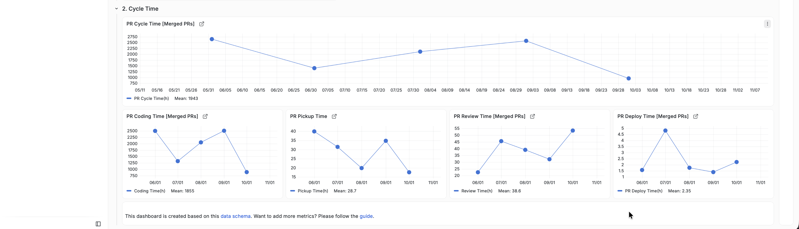
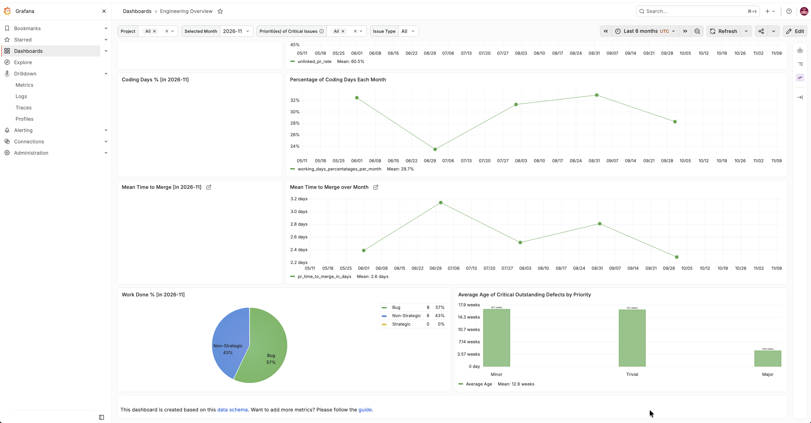
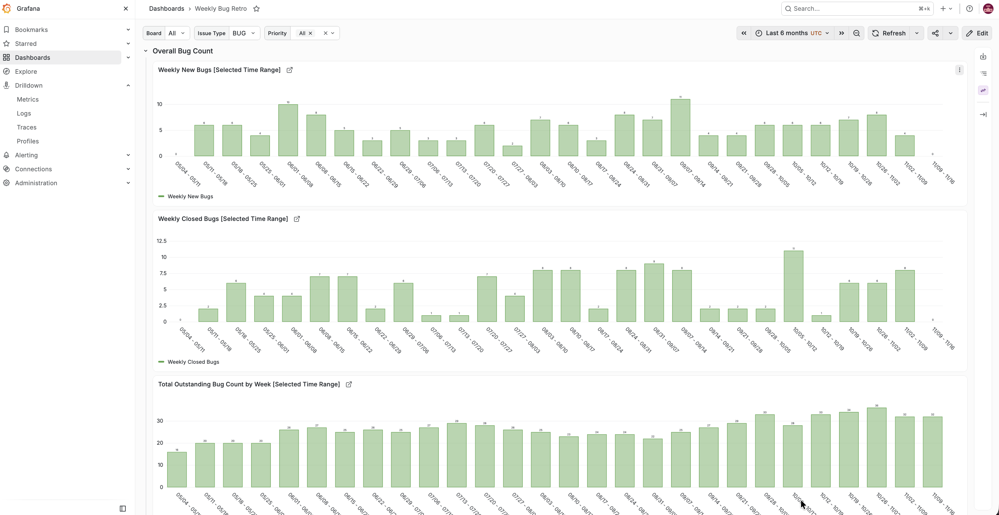

# MyDevLake

Local [Apache DevLake](https://devlake.apache.org/) deployment using Docker Compose.

## Services

| Service   | Port | Description                                      |
| --------- | ---- | ------------------------------------------------ |
| Config UI | 4000 | Web UI for managing connections                  |
| DevLake   | 8080 | Core API server                                  |
| Grafana   | 3002 | Dashboards (proxied via Config UI at `/grafana`) |
| MySQL     | 3306 | Backing database                                 |

## Quick start

```sh
cp env.example .env
# Edit .env — at minimum set ENCRYPTION_SECRET
docker compose up -d
```

Open <http://localhost:4000> to configure data connections.  
Grafana dashboards are at <http://localhost:4000/grafana> (or directly at <http://localhost:3002>).

## Dashboards

### DORA Metrics



Deployment frequency, lead time for changes, change failure rate, and failed deployment recovery time, benchmarked against the DORA 2023 report classifications.

### Engineering Throughput and Cycle Time



PRs opened/merged, issue completion, PR review depth, P0/P1 bug count, PR merged size, and PRs merged without review.

### PR Cycle Time Breakdown



PR cycle time decomposed into coding time, pickup time, review time, and deploy time.

### Engineering Overview



Coding days percentage, mean time to merge, work done breakdown by issue type, and average age of critical outstanding defects.

### Weekly Bug Retro



Weekly new bugs, closed bugs, and total outstanding bug count over time.

## Configuration

All settings live in `.env` — see `env.example` for the full reference. Key variables:

- `DB_URL` — database connection string
- `ENCRYPTION_SECRET` — encryption key for stored credentials
- `PLUGIN_DIR` / `REMOTE_PLUGIN_DIR` — plugin paths
- `PIPELINE_MAX_PARALLEL` — concurrent pipeline runs
- `AUTH_ENABLED` / `OIDC_ENABLED` — authentication (disabled by default)

## Version

DevLake **v1.0.3-beta18**
